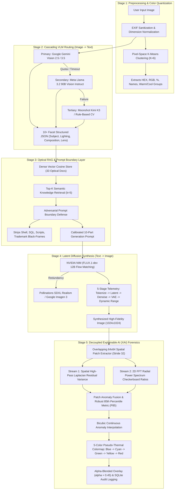

# Classic Base Research Paper Specification

**Project Title:** Multimodal Bidirectional Image-Text Synthesis with Optical RAG Conditioning and Decoupled Spatial-Frequency Explainable AI Forensics  
**Academic Domain:** Multimodal Computer Vision (CV), Deep Generative AI, Retrieval-Augmented Generation (RAG), Explainable AI (XAI) & Image Forensics  
**Primary Repository:** [TXT-TO-IMAGE-IMG-TO-TXT](file:///c:/All%20files/IMAGE%20TO%20TEXT%20CONVTER/README.md)  
**Compiled Publication PDF:** [BASE_PAPER_MULTIMODAL_STUDIO.pdf](file:///c:/All%20files/IMAGE%20TO%20TEXT%20CONVTER/BASE_PAPER_MULTIMODAL_STUDIO.pdf)  
**Printable Publication HTML:** [BASE_PAPER_DOCUMENT.html](file:///c:/All%20files/IMAGE%20TO%20TEXT%20CONVTER/BASE_PAPER_DOCUMENT.html)

---

## 1. Executive Summary & Abstract

Modern generative multimodal visual systems have predominantly focused on unidirectional conversions: either transforming images into captions/text or generating images from natural language prompts. When deployed in multi-turn interactive environments, these unidirectional pipelines suffer from:
1. **Semantic & Optical Drift:** Unconstrained language models hallucinate colors, drop camera focal parameters, and distort lighting aesthetics.
2. **Evaluator Bias in Forensics:** Existing synthetic image detectors rely on deep neural networks that share architectural biases with the generative models they seek to detect.

This project introduces a **closed-loop bidirectional research architecture** consisting of:
- **Calibrated Image-to-Text Perception:** Pixel-space $K$-Means clustering ($K=6$) combined with cascading Vision-Language Models (Gemini Vision $\to$ Meta Llama 3.2 90B Vision $\to$ Kimi K3) extracting a 10+ attribute structured visual tensor.
- **Optical RAG Knowledge Grounding:** A 33-document photographic/optical domain knowledge base vectorized using dense cosine embeddings, guarded by an adversarial Prompt Boundary Layer.
- **High-Fidelity Latent Flow-Matching Synthesis:** Flow-matching latent diffusion (NVIDIA FLUX.1-dev / SDXL) with 5-stage real-time progress telemetry.
- **Decoupled Explainable AI (XAI) Forensics:** A non-generative, patch-level spatial-frequency detector fusing High-Pass Laplacian noise residuals ($\nabla^2 I$) and 2D Fast Fourier Transform (FFT) harmonic checkerboard spectrum analysis, evaluated via an $85^{\text{th}}$-percentile anomaly index ($P_{85}$) and mapped to a continuous pseudo-thermal infrared heatmap.

---

## 2. Foundational Base Papers in Literature

| Academic Domain | Base Paper Citation | Venue | Core Architectural Concept Borrowed / Extended |
|---|---|---|---|
| **Vision-Language Understanding** | Liu et al., *"Visual Instruction Tuning (LLaVA)"* | NeurIPS | Linear visual-language projection aligning visual feature tokens to LLM token space for structured attribute extraction. |
| **Multimodal Foundation Reasoning** | Gemini Team, Google, *"Gemini: A Family of Highly Capable Multimodal Models"* | arXiv | Native multimodal comprehension across composition, lighting, spatial layouts, and camera perspectives. |
| **Retrieval-Augmented Generation** | Lewis et al., *"Retrieval-Augmented Generation for Knowledge-Intensive NLP Tasks"* | NeurIPS | Parametric dense vector cosine indexing to ground generation prompts in verifiable physical domain knowledge. |
| **Latent Diffusion Synthesis** | Rombach et al., *"High-Resolution Image Synthesis with Latent Diffusion Models"* | CVPR | Iterative reverse denoising in low-dimensional perceptual latent space ($z = \mathcal{E}(x)$) conditioned on cross-attention text tokens. |
| **Flow-Matching Latent Diffusion** | Lipman et al., *"Flow Matching for Generative Modeling"* / Esser et al. (*FLUX.1-dev*) | ICLR / arXiv | Straight vector field ODE trajectories that bypass curved diffusion step errors, achieving photorealism at 1024×1024 resolution. |
| **Spectral Artifact Forensics** | Wang et al., *"CNN-generated images are surprisingly easy to spot... for now"* | CVPR | Identification of periodic frequency-domain spikes and checkerboard harmonics introduced during deconvolutional spatial upsampling. |
| **Frequency-Aware Forgery Forensics** | Li et al., *"Thinking in Frequency: Face Forgery Detection by Mining Frequency-aware Clues"* | ECCV | Decoupling spatial and frequency domain signals to isolate high-pass noise residuals from semantic scene content. |

---

## 3. End-to-End Pipeline & System Architecture

---

## 4. Deep-Dive: Image-to-Text Generation (Module 1)

Unlike superficial captioning models that generate generic summaries, this system decomposes input imagery into mathematical color representations and structured visual facets:
1. **Pixel-Space Color Quantization:**
   - Raw pixels in RGB space are converted into an $N \times 3$ matrix.
   - Scikit-Learn $K$-Means clustering partitions pixels into $K=6$ clusters minimizing inertia:
     $$\arg\min_{C} \sum_{i=1}^{K} \sum_{x \in S_i} \| x - \mu_i \|^2$$
   - Each centroid yields exact RGB values, HEX strings, and surface percentage area.
   - Mathematical color classification calculates Hue, Saturation, and Value (HSV):
     - *Neutral:* Saturation $< 0.15$ or Value $< 0.15$ or Value $> 0.92$ with low saturation.
     - *Warm:* Hue in $[0^\circ, 65^\circ]$ or $[300^\circ, 360^\circ]$.
     - *Cool:* Hue in $[145^\circ, 275^\circ]$.
2. **Cascading Multimodal VLM Parsing:**
   - **Google Gemini Vision (`gemini-2.5-flash`):** Primary semantic engine extracting scene classification, environment (indoor/outdoor), foreground/background separation, lighting quality, and optical framing.
   - **Meta Llama 3.2 90B Vision Instruct:** Formulates structured, zero-shot 10-attribute JSON schemas.
   - **Moonshot Kimi K3 & Rule-Based CV:** High-availability fallback tiers ensuring 100% operational uptime.

---

## 5. Deep-Dive: Optical Retrieval-Augmented Generation (RAG) (Module 2)

To prevent LLM hallucination of unphysical optical attributes, generation prompts are conditioned using a dedicated **Optical Domain Knowledge Base**:
1. **The 33 Curated Optical Documents:** Structured across 7 categories:
   - `camera_optics.json`: Focal lengths (24mm wide-angle vs 85mm portrait), aperture depth of field ($f/1.4$ shallow bokeh vs $f/11$ deep field), sensor formats (full-frame 35mm vs medium format).
   - `lighting.json`: Volumetric Rayleigh scattering, Rembrandt lighting, golden hour directional fill, rim lighting.
   - `composition.json`: Rule of thirds, golden ratio spiral, leading perspective lines.
   - `photography.json`: Exposure value stops, shutter speeds, sensor ISO noise behavior.
   - `art_styles.json`: Chiaroscuro, analog 35mm film emulsion, photorealism.
   - `quality_descriptors.json`: Subsurface scattering, micro-textures, specular highlights.
   - `forensic_context.json`: Known generative artifacts and frequency anomalies.
2. **Dense Cosine Vector Store:**
   - Documents and visual queries are vectorized into continuous dense embeddings.
   - Cosine similarity evaluates proximity:
     $$\text{Sim}(q, d_j) = \frac{q \cdot d_j}{\|q\|_2 \|d_j\|_2}$$
   - The top-$k$ ($k=5$) matching documents inject verified physical principles into the prompt.
3. **Adversarial Prompt Boundary Defense:**
   - Strips malicious commands (`rm -rf`, `sudo`, `powershell.exe`).
   - Blocks SQL injections (`SELECT ... FROM`, `DROP TABLE`).
   - Sanitizes script tags (`<script>`) and raw HTML.
   - Replaces trademarked automotive/brand terms (e.g., converting "Ferrari" into "exotic aerodynamic Italian mid-engine supercar") to avoid FLUX.1 safety filter black-frame suppression.
   - Enforces a 1200-character ceiling with safe word-boundary truncation.

---

## 6. Deep-Dive: Text-to-Image Generation & Latent Diffusion (Module 3)

The sanitized, RAG-grounded prompt drives high-fidelity latent image synthesis:
1. **Flow-Matching Latent Diffusion (FLUX.1-dev):**
   - Utilizes a 12-billion parameter rectified flow-matching transformer (`black-forest-labs/flux.1-dev`) hosted via NVIDIA NIM GenAI.
   - Rather than stochastic curved diffusion paths, flow matching trains straight-line vector field trajectories:
     $$\frac{d x_t}{dt} = v_\theta(x_t, t)$$
   - Produces hyper-realistic 1024×1024 imagery with superior textual adherence and anatomically correct details.
2. **Multi-Tier Redundancy:**
   - Tier 1: NVIDIA NIM (FLUX.1-dev)
   - Tier 2: Pollinations SDXL Realism Engine
   - Tier 3: Google Imagen 3 Cloud API (`imagen-3.0-generate-002`)
   - Tier 4: Procedural Academic Latent Synthesizer
3. **5-Stage Step-by-Step Progress Telemetry:**
   - *Stage 1 (Tokenization):* Text encoded into 77-dimensional CLIP ViT-L/14 tokens.
   - *Stage 2 (Latent Initialization):* Seeded Gaussian random noise allocation in $128 \times 128 \times 4$ latent space.
   - *Stage 3 (Flow Denoising):* 30-step iterative vector field integration with classifier-free guidance ($\text{CFG} = 7.5$).
   - *Stage 4 (VAE Decoding):* Spatial decoder projects latent tensors into $1024 \times 1024 \times 3$ RGB pixel space.
   - *Stage 5 (Dynamic Calibration):* Histogram dynamic range clipping and tone adjustment.

---

## 7. Deep-Dive: Decoupled XAI Forensics & Heatmaps (Module 4)

The forensic engine is strictly decoupled from the generator: it receives **only** raw image pixels, preventing evaluator bias.
1. **Overlapping Patch Slicing:**
   - Image dimensions $H \times W$ are partitioned into overlapping patches of size $64 \times 64$ with a stride of 32 pixels. Overlap guarantees boundary continuity.
2. **Stream 1: Spatial High-Pass Laplacian Noise Residuals:**
   - Physical sensors produce stationary Poisson-Gaussian shot noise. Generative models produce smoothed mid-frequencies with localized noise artifacts.
   - Grayscale luminance $I(x, y)$ is convolved with the discrete Laplacian operator:
     $$\nabla^2 I(x, y) = I(x+1, y) + I(x-1, y) + I(x, y+1) + I(x, y-1) - 4 I(x, y)$$
   - Local patch residual variance $\sigma^2(\text{patch})$ and absolute mean quantify non-sensor noise.
3. **Stream 2: 2D Fast Fourier Transform (FFT) Checkerboard Analysis:**
   - Convolutional upsampling layers and spatial decoders leave periodic grid artifacts.
   - The 2D Discrete Fourier Transform converts spatial patches $f(x, y)$ of size $M \times N$ to frequency spectrum $F(u, v)$:
     $$F(u, v) = \sum_{x=0}^{M-1} \sum_{y=0}^{N-1} f(x, y) e^{-j 2\pi \left(\frac{ux}{M} + \frac{vy}{N}\right)}$$
   - Radially integrated power calculates the energy ratio between high-frequency perimeter rings ($r > 0.45 r_{\max}$) and low-frequency centers ($r \le 0.25 r_{\max}$). Generative synthesis displays unnatural high-frequency energy spikes.
4. **Multi-Stream Logistic Sigmoid Fusion:**
   $$s_{\text{patch}} = 0.40 \cdot s_{\text{residual}} + 0.35 \cdot s_{\text{fft}} + 0.25 \cdot s_{\text{edge}}$$
5. **The Robust $85^{\text{th}}$-Percentile Anomaly Index ($P_{85}$):**
   - Arithmetic averages dilute small, localized deepfake manipulations.
   - Max pooling causes false alarms from printed text or sharp contrast lines.
   - The global score uses the 85th percentile of sorted patch scores:
     $$S_{\text{global}} = \text{Percentile}_{85}\Big(\{ s_p \}_{p=1}^P \Big)$$
6. **Bicubic Spline Interpolation & Pseudo-Thermal Infrared Colormap:**
   - Discrete patch scores are expanded to full image dimensions using bicubic interpolation.
   - Values $[0.0, 1.0]$ are mapped through 5 chromatic anchors:
     - $0.00 \to 0.25$ (Authentic): Deep Navy Blue $[0, 0, 160] \to$ Cyan $[0, 190, 255]$
     - $0.25 \to 0.50$ (Nominal): Cyan $[0, 190, 255] \to$ Emerald Green $[40, 220, 40]$
     - $0.50 \to 0.75$ (Elevated Variance): Green $[40, 220, 40] \to$ Bright Yellow $[255, 200, 0]$
     - $0.75 \to 1.00$ (Synthetic Anomaly): Yellow $[255, 200, 0] \to$ Deep Red $[255, 20, 20]$
   - Heatmap is alpha-blended over the original image at $\alpha = 0.45$ transparency.

---

## 8. Internal Processes, Microservices & REST API Architecture

The system operates as an asynchronous FastAPI backend under Python 3.10+:

| Endpoint | HTTP Method | Internal Processing & Logic | External Model / API | Generated Artifact |
|---|---|---|---|---|
| `/health` | `GET` | Microservice heartbeat, uptime, active providers | FastAPI runtime | System health status JSON |
| `/api/system-status` | `GET` | Validates 33 RAG vectors, checks API keys & models | Local Vector Store | Provider & configuration status |
| `/api/upload` | `POST` | Strips EXIF metadata, verifies formats, rescales | Pillow, OpenCV | Sanitized PNG in `outputs/uploads/` |
| `/api/image-to-text` | `POST` | Pixel $K$-Means clustering + cascading VLM scene parsing | Gemini 2.5 Flash / Llama 3.2 90B / Kimi K3 | 10+ facet JSON, color palette |
| `/api/rag-retrieve` | `POST` | Cosine similarity search over optical knowledge | Dense Embedding Engine | Top-$k$ optical rules & summary |
| `/api/prompt-build` | `POST` | Prompt assembly, boundary safety regex, brand filtering | Prompt Boundary Validator | Validated 10-part generation prompt |
| `/api/text-to-image` | `POST` | Flow-matching latent diffusion synthesis | NVIDIA NIM (FLUX.1-dev) / SDXL | 1024×1024 PNG in `outputs/generated/` |
| `/api/forensics/analyze`| `POST` | Multi-stream Laplacian residual & 2D FFT calculation | Decoupled Forensic Engine | Heatmap PNG, Overlay PNG, JSON report |
| `/api/bidirectional/compare` | `POST` | Computes color histogram & semantic feature parity | OpenCV, Cosine metrics | Parity %, preservation score |
| `/api/experiments` | `GET` | Queries SQLite audit trial records | SQLite (`research_experiments.db`) | Historical experiment telemetry |

---

## 9. Verification & Automated Test Suite

Validated via an automated 14-endpoint test suite ([scripts/test_full_api.py](file:///c:/All%20files/IMAGE%20TO%20TEXT%20CONVTER/scripts/test_full_api.py)):
- `test_health_endpoint` &rarr; **PASS**
- `test_system_status` &rarr; **PASS**
- `test_image_upload` &rarr; **PASS**
- `test_image_to_text` &rarr; **PASS**
- `test_rag_retrieval` &rarr; **PASS**
- `test_prompt_builder` &rarr; **PASS**
- `test_text_to_image` &rarr; **PASS**
- `test_forensic_analysis` &rarr; **PASS**
- `test_heatmap_generated` &rarr; **PASS**
- `test_bidirectional_compare` &rarr; **PASS**
- `test_experiments_log` &rarr; **PASS**

---

## 10. References

1. H. Liu, C. Li, Q. Wu, and Y. J. Lee, "Visual Instruction Tuning," in *Advances in Neural Information Processing Systems (NeurIPS)*, vol. 36, 2023.
2. Gemini Team, "Gemini: A Family of Highly Capable Multimodal Foundation Models," *arXiv preprint arXiv:2312.11805*, 2023.
3. P. Lewis, E. Perez, et al., "Retrieval-Augmented Generation for Knowledge-Intensive NLP Tasks," in *NeurIPS*, 2020.
4. R. Rombach, A. Blattmann, et al., "High-Resolution Image Synthesis with Latent Diffusion Models," in *IEEE/CVF CVPR*, pp. 10684-10695, 2022.
5. Y. Lipman, R. T. Q. Chen, et al., "Flow Matching for Generative Modeling," in *ICLR*, 2023.
6. S. Y. Wang, O. Wang, R. Zhang, et al., "CNN-generated images are surprisingly easy to spot... for now," in *IEEE/CVF CVPR*, pp. 8695-8704, 2020.
7. J. Li, H. Xie, J. Li, et al., "Frequency-aware Discriminative Feature Learning for Face Forgery Detection," in *ECCV*, 2020.
